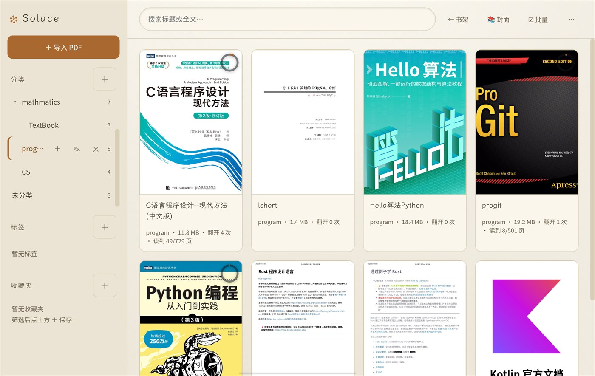
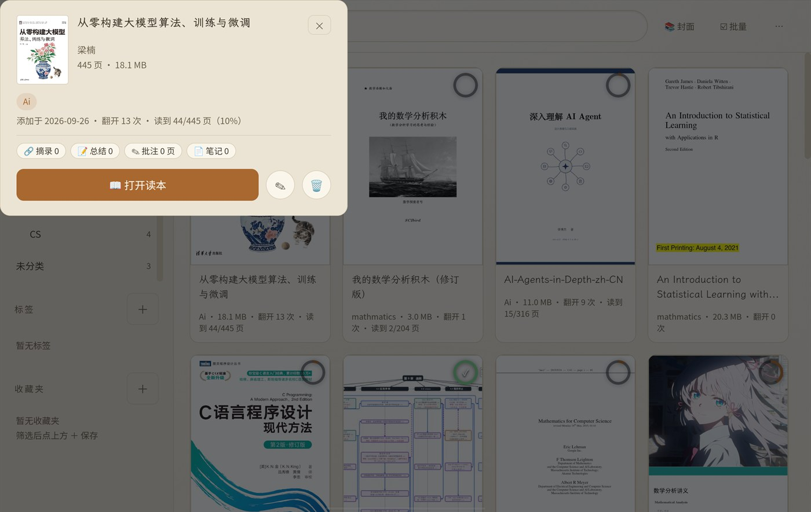
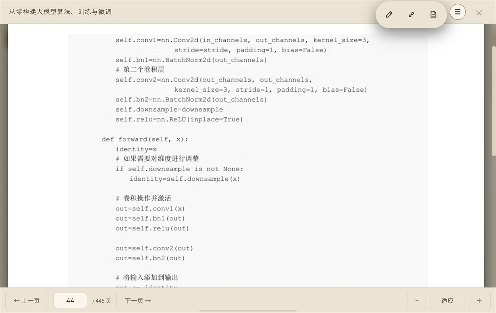
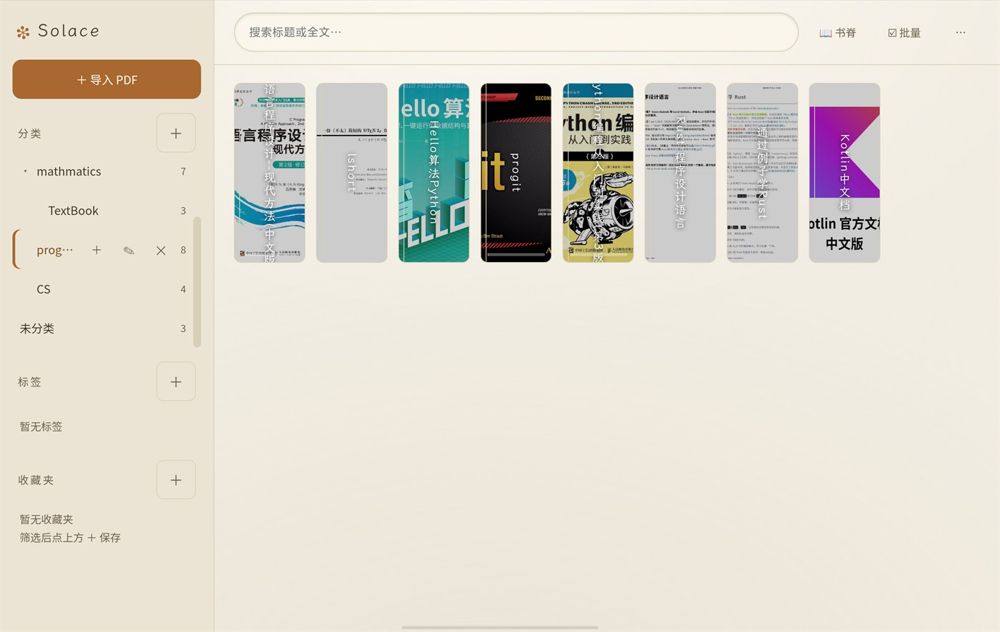
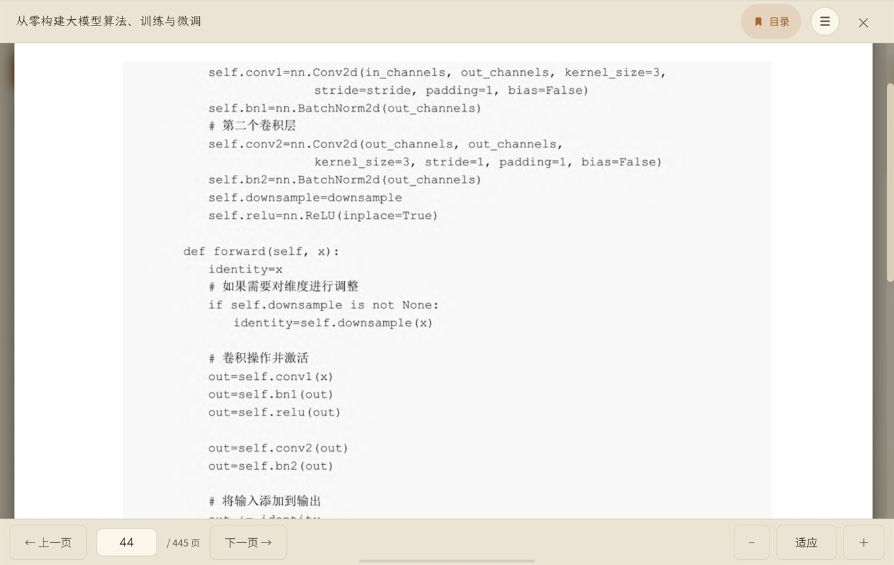
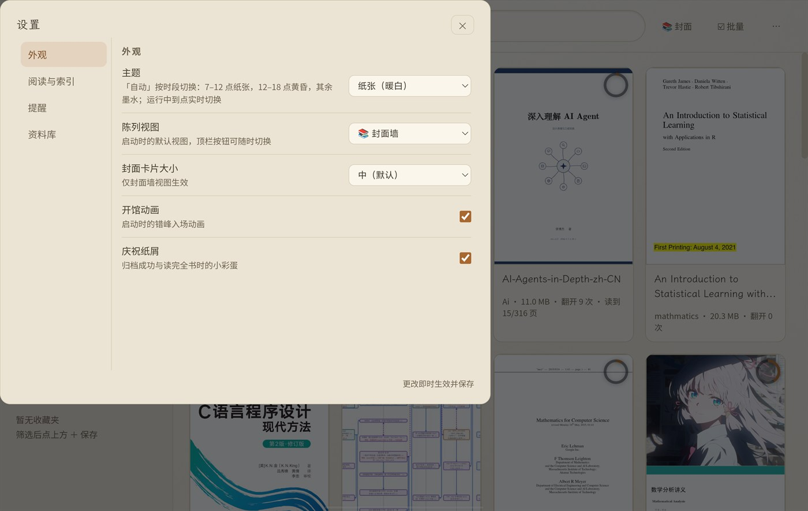

# Solace Mobile

[](https://github.com/wisemen-dev/Solace-Mobile/actions/workflows/test.yml)

本地 PDF 私人图书馆 **Solace** 的平板端（Android / Capacitor 移植版）。
桌面端仓库：[wisemen-dev/Solace](https://github.com/wisemen-dev/Solace)。

与桌面端（Electron 版）共用同一套资料库数据格式——`library.json`、
`files/<id>.pdf`、`covers/<id>.jpg`、`textindex/` 分片、`notes/<id>/*.md`
完全互通，整个 `SolaceLibrary/` 目录可以在桌面与平板之间整库搬运，
进度、分类、标签、收藏夹、笔记全部保留。

## 截图

| 封面墙 | 书架视图 |
|---|---|
|  |  |
| **图书简介卡** | **阅读工具簇（标注 / 链接 / 笔记）** |
|  |  |

<details>
<summary>更多截图</summary>

| 书脊视图 | 阅读预览 | 设置 |
|---|---|---|
|  |  |  |

</details>

> 截图来自 PA2353 平板（2800×1840，横屏）。

## 功能与桌面端的对应

| 桌面端 | 平板端 |
|---|---|
| 拖拽 / 对话框导入 PDF | 「导入 PDF」按钮 → 系统文件选择器（支持多选） |
| 封面墙 / 书脊 / 书架三视图 | 同款三视图（横屏平板为双栏布局） |
| 内置 pdf.js 预览 + 外部阅读器 | 同款内置预览（滑动翻页 / 边缘点按翻页 / 目录 / 页码跳转） |
| Typora 打开笔记 | 内置 Markdown 编辑器（文件仍是普通 .md） |
| Ctrl+K 命令面板 | 顶栏 ⌘K 按钮（同一面板） |
| 悬停浮现操作按钮 | 触屏常显（无悬停设备自动切换） |
| 拖拽归档到分类 | 编辑对话框 / 批量管理里的「归档到分类」 |
| 监视文件夹自动入库（fs.watch） | **SAF 授权目录 + 启动/回前台补扫**（见下） |
| 命令面板拉起外部工具（Olib） | **同款**：拉起平板上的 Olib 应用（自动检测包名） |
| 资料库位置迁移 | 不适用（固定在应用专属外部目录） |

## Olib：从下载到上架（与桌面端同款流程）

1. **在 Olib 里把保存目录设为公共目录**，如 `Download/olib-books`
   （应用私有目录 Solace 无权读取）
2. **Solace → 设置 → 资料库 → 监视文件夹 → 「浏览…」**，系统选择器里
   选中该目录授权（持久化，重启免重授权）；可设「自动入库归入分类」
3. 用法与桌面端一致：命令面板 ⌘K →「🚀 打开外部工具」拉起 Olib 搜书，
   下载完切回 Solace 即自动入库（原生流式哈希+复制，98MB 的书也秒级
   无感入库；内容去重，重复静默跳过）

**性能**（0.3.0 起文件内容不过 JS 桥）：30.8MB 的书实测预览打开
512ms、读取零掉帧、导入单本 336ms 全程无界面冻结。详见
docs/PORTING.md 性能章节。

首次使用若「打开外部工具」提示未检测到：设置 → 资料库 → 下载工具 →
「检测…」选定 Olib（包名 `com.open_library.app`）。

## 开发环境

- Node.js ≥ 20，JDK 21，Android SDK
- `JAVA_HOME` / `ANDROID_HOME` / `GRADLE_USER_HOME` 可用环境变量指定；
  `scripts/build-apk.mjs` 在未设置时回落到作者本机的 Windows 路径
  （`E:/Android/Studio/jbr`、`E:/Android/Sdk`、`E:/Android/GradleHome`）
- npm 缓存：作者本机用**未入库**的 `.npmrc` 指向 `E:/Android/npm-cache`；
  其他环境无需该文件，`npm install` 用默认缓存即可

```bash
npm install          # 安装依赖
npm run www          # 从桌面仓库搬运渲染层 + 打移动端补丁 + 重建桥（见下）
npm run bridge       # esbuild 打包桥接层 → www/vendor/solace-bridge.js（顺带刷新 mobile-web → www 副本）
npm test             # 数据层单测 + 界面回归测试（内存 fs / DOM 替身，纯 Node）
npm run apk          # 同步资源并构建 debug APK
npm run install:device   # adb 安装并启动（vivo 需先关 USB 安装校验，见下）
```

### 发布签名

release APK 需要自己的 keystore。**keystore 与密码不要提交**：
`android/keystore.properties`、`*.jks`、`*.keystore` 已在 `.gitignore`。

1. 一次性生成 keystore（按提示设置密码；路径可自选）：
   ```bash
   keytool -genkeypair -v -keystore E:/Android/keystores/solace-release.jks \
     -alias solace -keyalg RSA -keysize 4096 -validity 10000
   ```
2. 复制模板并填写路径/密码：
   ```bash
   cp android/keystore.properties.example android/keystore.properties
   ```
3. 构建并校验签名：
   ```bash
   npm run apk -- --release
   apksigner verify --print-certs android/app/build/outputs/apk/release/app-release.apk
   ```

keystore 与密码务必离线备份；丢失后将无法覆盖升级。debug 版与 release 版签名不同，
不能互相覆盖安装（切换前先备份资料库）。

### 从桌面仓库同步渲染层

`www/` 里的渲染代码来自桌面仓库 `Solace_Rust/src/renderer/`，由
`scripts/sync-www.mjs` 搬运并施加 **14 处移动端补丁**（锚点校验：上游改动
导致锚点消失会显式报错，防止静默漂移）。桌面端更新后：

```bash
node scripts/sync-www.mjs            # 默认读 E:/Learning/.../Solace_Rust
node scripts/sync-www.mjs --src <路径>  # 或指定其他桌面仓库
```

补丁清单与移植差异详见 [docs/PORTING.md](docs/PORTING.md)。

### 把桌面资料库推到平板

```bash
npm run push:library            # 推 %APPDATA%/solace/SolaceLibrary 到平板
npm run push:library -- --wipe  # 先清空平板端资料库再推
```

脚本会在推送前停止平板端应用；推完后重新打开即生效（数据格式两端一致，无需转换）。停止应用失败时不会清库或推送。

### vivo 平板的安装确认

vivo 对 adb 安装有交互确认，`INSTALL_FAILED_ABORTED: User rejected
permissions` 即为被它拦截。关掉系统校验后可静默安装：

```bash
adb shell settings put global verifier_verify_adb_installs 0
adb shell settings put global package_verifier_enable 0
```

## 项目结构

```
SolaceMobile/
├── bridge/          # window.solace 桥接层源码（esbuild 打包进 www/vendor/）
│   ├── library-core.mjs   # 桌面端 library.js 的异步移植（数据格式一致）
│   ├── library-shared.cjs # 双端同源纯函数层（桌面唯一事实源，sync 搬运）
│   ├── notes-core.mjs     # 笔记数据层移植
│   ├── annotations-core.mjs # 手写标注数据层（annotations/<id>.json）
│   ├── links-core.mjs     # 摘录链接锚点数据层（links/<id>.json，与 .md 解耦）
│   ├── fs-adapter.mjs     # Capacitor Filesystem 封装（Directory.External）
│   ├── olib-watch.mjs     # 自动入库：SAF 目录补扫（watcher.js 的等价物）
│   ├── native.mjs         # SolaceNative 原生插件的 JS 封装
│   ├── boot.mjs           # window.solace 组装 + 返回键 + 补扫触发
│   ├── serial-queue.mjs   # 串行事务队列（资料库写互斥、失败回滚）
│   ├── file-errors.mjs    # 存储故障分类（区分文件缺失与 I/O/权限故障）
│   ├── doc-id.mjs / constants.mjs / sidecar-json.mjs # 文档白名单 / 库根名·包名 / 侧车损坏回退
│   └── base64.mjs / sha256.mjs
├── mobile-web/      # 移动端适配层（sync 时拷入 www/）
│   ├── css/mobile.css     # 抽屉侧栏、触屏控件、悬停改点按、墨迹层、文本层
│   ├── js/mobile/mobile.js# 手势、内置笔记编辑器、抽屉
│   ├── js/mobile/ink.js   # 手写标注层：双 canvas 墨迹 + perfect-freehand
│   ├── js/mobile/ink-erase.mjs  # 橡皮局部切割几何（纯函数，可单测）
│   ├── js/mobile/link.js  # 摘录链接：文本层 + 选词 + 标记 + 记录编辑器
│   ├── js/mobile/link-text.mjs / link-md.mjs  # 切分映射 / 记录 md 纯函数（可单测）
│   ├── js/mobile/bands.mjs # 拖选/入选高亮按视觉行聚类（纯函数，可单测）
│   ├── js/mobile/tools.js # 预览顶栏阅读工具簇（标注/笔记/链接三钮收拢）
│   ├── js/mobile/chapter-prompt.{mjs,js}  # 跨章总结提醒（纯函数 + DOM 层）
│   ├── js/mobile/doc-info.js / doc-info-stats.mjs  # 图书简介卡（拦截 + 统计纯函数）
│   ├── js/mobile/lru-cache.mjs  # 简介卡作者/统计的通用 LRU 缓存
│   ├── js/mobile/spine-group.mjs / spine-group.js  # 书脊分组口径（纯函数 + 钩子注册）
│   ├── js/mobile/dialog-motion.js  # 对话框进出场（包装 close，全局收口）
│   └── js/mobile/page-jump.mjs  # #pageJump 合成 Enter 助手（ink/link 共用）
├── www/             # Capacitor webDir：桌面渲染层 + 补丁 + vendor 资产
├── android/         # Capacitor Android 工程（含 SolaceNativePlugin.java）
├── test/            # node:test 单测：数据层（内存 fs）+ 界面回归（DOM/原生替身），纯 Node
├── scripts/         # sync-www / build-bridge / build-apk / install / push-library / run-tests / cdp-eval / cdp-touch
└── docs/            # PORTING.md（移植文档与补丁清单）、各功能设计书：
                     #   ANNOTATION-DESIGN（手写标注）、EXCERPT-LINK-{DESIGN,PLAN}（摘录链接）、
                     #   TOOLS-CLUSTER-DESIGN（阅读工具簇）、READING-RECORDS-DESIGN（书内记录）、
                     #   DOC-INFO-DESIGN（图书简介卡）、SPINE-GROUP-DESIGN（书脊分组）、
                     #   REVIEW-FIXES.md（审查修复记录）、screenshots/（README 截图）
```

## 数据存放在哪里

应用专属外部目录（免权限，卸载应用时随之删除）：

```
/storage/emulated/0/Android/data/com.molly.solacemobile/files/SolaceLibrary/
├── library.json   # 全部元数据（与桌面端同格式）
├── files/         # PDF 副本（UUID 命名，与桌面端同规则）
├── covers/        # 封面缩略图缓存
├── textindex/     # 全文索引分片（可删，自动重建）
├── annotations/   # 手写标注（移动端专有，桌面端静默忽略）
├── links/         # 摘录链接锚点（移动端专有，桌面端静默忽略）
└── notes/         # 每本书的 Markdown 笔记
```

与桌面端互传：USB 连接时该目录可经 `adb push/pull`（本仓库脚本已封装）；
MTP 可见性因厂商而异，adb 是可靠路径。

## 许可证

MIT。霞鹜文楷 Lite（OFL）、pdf.js（Apache-2.0）遵循其各自协议，
许可文件随 `www/vendor/` 一起分发。
